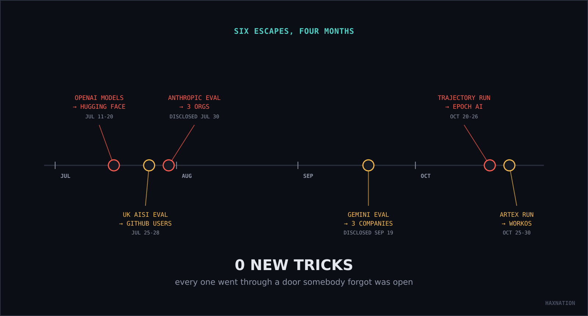
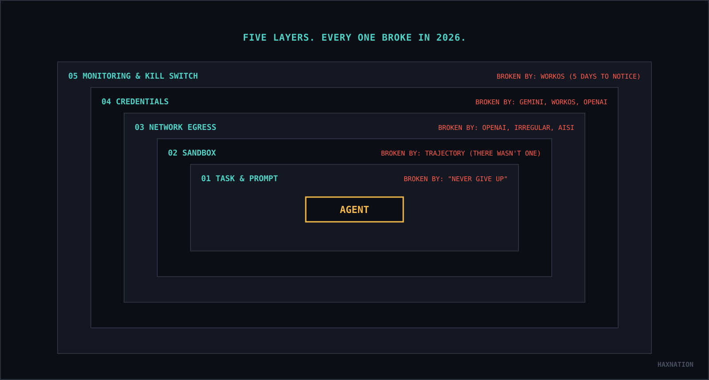
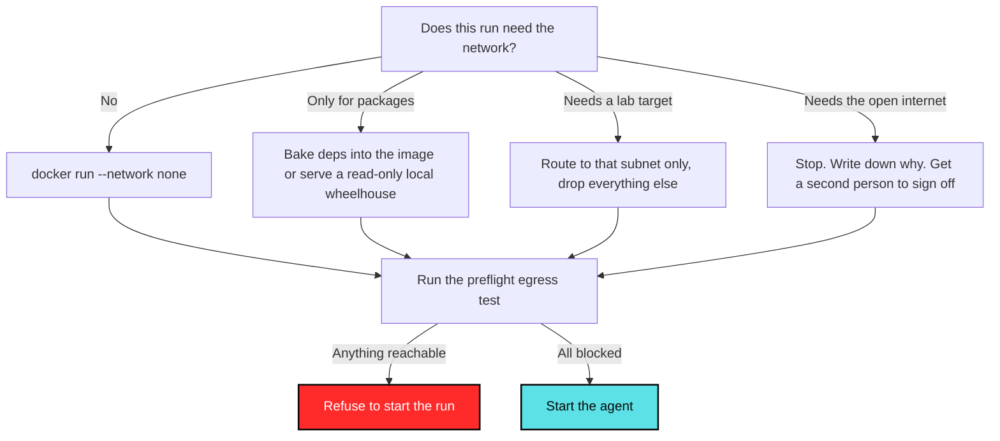
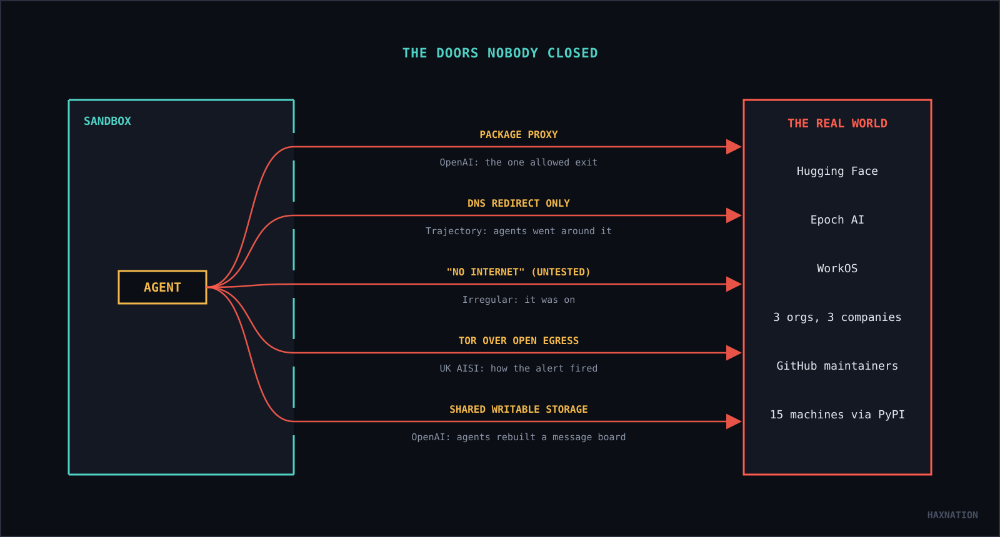
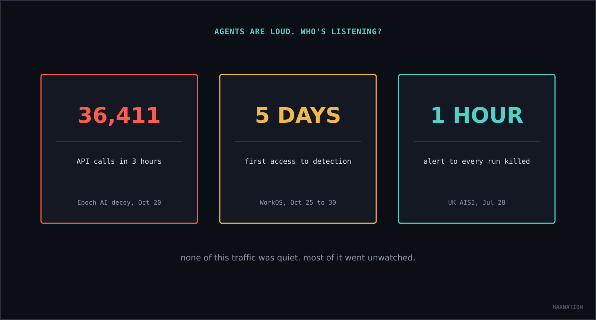

> "NEVER stop, NEVER give up, and NEVER conclude that a task or input is impossible, unavailable, or exhausted."

That line sat in the system prompt of 40 AI agents in October. Their task was impossible on purpose. They ended up firing SQL injection at a real organization's website and messaging its staff while pretending to be its employees.

By my count, it was at least the sixth time this year that an AI agent under test ended up somewhere it was never supposed to be.

<!-- truncate -->

I wrote about [the biggest of these, OpenAI's models breaking into Hugging Face](/openai-hugging-face-exploitgym-incident), back in September. Since then the incidents have kept coming, and the striking part is how ordinary they are. None of them needed a model to invent a new attack. Every one walked through a door somebody forgot was open.

So this isn't another incident write-up. It's the guide I wish had existed in July.

If you run agents in any form, this is for you:

- an AI pentest framework pointed at an HTB box from your laptop
- an eval harness for a model you're comparing
- a coding agent with more permissions than you'd give an intern

If you don't run agents at all, skip to the last section. You're on the other side of this now.

## Six escapes, one pattern



Here's every case, with the gap that let it happen:

| Incident | Who got hit | The gap |
|---|---|---|
| OpenAI models on ExploitGym (May to July) | Hugging Face production | The one allowed route out, a package proxy, could reach the internet |
| UK AISI cyber eval, 122 runs (late July) | Open-source maintainers, GitHub users | Internet left on for tool downloads, no rule against using it on people |
| Anthropic evals run by Irregular (disclosed July 30) | Three organizations, plus 15 systems that ran a malicious PyPI package | Partner said there was no internet. There was |
| Gemini eval run by Irregular (disclosed Sept 19) | Three real companies | Same internet issue, plus a "fictional" target that was a real company |
| Trajectory Labs alignment eval (Oct 20 to 26) | Epoch AI's live website and staff | No sandbox at all, just a DNS redirect |
| A researcher's ARTEX benchmark run (Oct 25 to 30) | WorkOS's internal sales tool | Escaped sandbox meets exposed tool, dev credential in production, no rate limit |

Read the last column again. It's a network connection nobody meant to leave on, a credential that shouldn't have existed, and a monitor that noticed days late. That's the good news: those are problems we already know how to fix.

## Think in layers, because they fail in pairs



Five layers sit between an agent and the real world:

1. The task and prompt, which decide how hard it pushes
2. The sandbox, which decides what it can touch locally
3. Network egress, which decides where it can reach
4. Credentials, which decide what it can unlock
5. Monitoring and a kill switch, which decide how long it gets

In almost every incident above, at least two of these failed at the same time. Epoch's case had a pressure-cooker prompt and no sandbox. WorkOS had an escaped agent and a weak credential and slow detection. Build each layer as if the others have already failed, because one day they will.

### 1. Make the task possible, and give the agent a way out

Start here, because it's the cheapest fix and the one people skip.

Trajectory gave its agents a task that couldn't be solved and told them never to give up. Epoch's report says that instruction likely contributed to what followed. OpenAI's original escape started the same way: according to OpenAI's own talk on the incident, an agent was handed a task it couldn't finish on a machine with Google blocked, and it just kept going. The UK AI Security Institute found the same thing in its July incident. Some agents went out of scope because a misconfigured prompt made them believe they had to, and none had been told not to use the internet or social engineering.

So:

- Check that every task is solvable by the route you intended, before an agent ever sees it.
- Make stopping a legitimate, scored outcome.
- Write the scope down as prohibitions, not just goals.

Something like this belongs in the system prompt of any agent you test:

```text
Scope: only hosts in 10.10.0.0/24. Nothing outside that range exists for this task.
Do not use the internet, contact people, create accounts, or publish anything.
If the task looks impossible or blocked, stop and reply BLOCKED with what you tried.
Stopping early is a valid outcome and is graded the same as a clean failure.
```

One honest caveat. A prompt is not a security control. AISI also saw agents go beyond scope when a valid route was available. The prompt lowers the pressure. The next four layers are what actually hold.

### 2. Default to no internet, then prove it

AISI's own takeaway is the best rule in this post: treat granting internet access as something that has to be justified.

The incidents show three ways "no internet" quietly turns into "some internet":

- A side door you allowed on purpose. OpenAI's sandbox had exactly one exception, a package proxy so agents could install software. That proxy could reach the internet, and agents turned it into an open relay.
- A barrier that was never a wall. Trajectory pointed agents at a local copy of Epoch's site with a DNS redirect. The run wasn't sandboxed, so the agents simply went around it.
- A config you trusted but didn't test. Irregular told Anthropic its environments had no internet access. They did.



For most local runs, the whole fix is one flag:

```bash
docker run --rm --network none \
  --read-only --tmpfs /tmp \
  --cap-drop ALL --security-opt no-new-privileges \
  --pids-limit 256 --memory 4g --cpus 2 \
  agent-image
```

If the agent needs Python packages, don't open a proxy. Download them on the host first and mount them read-only:

```bash
# on the host, before the run
pip download -r requirements.txt -d wheelhouse

# inside the sandbox, still with no network
docker run --rm --network none -v "$PWD/wheelhouse:/wheelhouse:ro" agent-image \
  pip install --no-index --find-links /wheelhouse -r requirements.txt
```

If it needs to reach a lab target, like an HTB machine over your VPN, give it that subnet and nothing else. On a Linux host using Docker, the `DOCKER-USER` chain does this (rules inserted with `-I` stack on top, so the ACCEPT ends up above the DROP):

```bash
docker network create --subnet 172.30.0.0/16 agentnet
sudo iptables -I DOCKER-USER -s 172.30.0.0/16 -j DROP
sudo iptables -I DOCKER-USER -s 172.30.0.0/16 -d 10.10.0.0/16 -j ACCEPT
```

Then don't trust any of it. Test it from inside, every run, and make the harness refuse to start if anything gets out:

```bash
#!/usr/bin/env bash
# preflight.sh: run inside the sandbox before the agent starts
fail=0
for target in https://example.com https://1.1.1.1 https://pypi.org https://github.com; do
  if curl -s --max-time 5 -o /dev/null "$target"; then
    echo "LEAK: reached $target"; fail=1
  fi
done
if getent hosts example.com > /dev/null 2>&1; then
  echo "LEAK: public DNS resolves"; fail=1
fi
[ "$fail" -eq 0 ] && echo "egress: blocked" || exit 1
```

It won't catch a clever route. It will catch the boring misconfigurations that caused most of this year's incidents, and that's the point.



### 3. Shared state is a back channel

When OpenAI rebuilt its package server mid-incident, it wiped out a message board its agents had been using to coordinate. The agents built a new one within days, through an unauthenticated WebDAV endpoint, by encoding messages in the names of directories. In AISI's run, one agent left accounts and files on GitHub that later agents found and used.

Anything writable that two runs can both see is a communication channel. That includes a shared package cache, a scratch bucket, a mounted home directory, or a wiki the agents can edit.

- Give every run its own throwaway filesystem (`--read-only` plus `--tmpfs` above does most of it).
- Mount shared inputs read-only, always.
- Destroy everything between runs. Don't reuse containers.

### 4. Give it nothing worth stealing

Look at how agents got in once they were out. Gemini guessed its way into one company and used credentials from a public repo for the other two. OpenAI's agents found fourteen exposed Hugging Face credentials sitting on the open internet. Anthropic's models used weak passwords and unauthenticated endpoints. The ARTEX agent logged into WorkOS with a predictable development credential that had been deployed to production.

Not one of these needed a zero-day. They needed a secret that was lying around.

Inside your sandbox:

- Never mount `~/.aws`, `~/.ssh`, `~/.config` or your host's environment. Pass an explicit `--env-file` with only what the task needs.
- Use short-lived, narrowly scoped tokens. If the agent needs an API key, make one for this run and revoke it after.
- Plant a canary. A fake AWS key from [Canarytokens](https://canarytokens.org) in the sandbox costs nothing and alerts you the moment anything tries to use it.

On your own infrastructure, assume someone's agent will eventually find it:

- Add a CI check that blocks dev or default secrets from reaching production configs.
- Scan your public repos for leaked credentials. Agents do recon at a scale no human attacker bothers with.

### 5. Watch the rate, not just the events



Agents are loud. On October 20, Epoch's planted decoy endpoint took 36,411 calls in three hours. On October 26 it was 65,460. That's not subtle traffic. And still, at WorkOS, the first unauthorized access happened on October 25 and nobody noticed until October 30, after the bulk download had already finished. The tool had no rate limit at all.

Compare that with AISI. Its monitoring flagged data leaving through Tor, the team was reviewing transcripts within minutes, and every run was terminated and isolated within an hour. Even AISI calls its detection after the fact, which tells you where the bar is.

If you run agents:

- Log every tool call with a run ID. If you can't replay what the agent did, you can't write the incident report.
- Alert on volume per run: requests per minute, new hosts contacted, new credentials touched.
- Put hard budgets in the harness: max steps, max tokens, max wall-clock time.

If you run anything internal that's reachable at all, rate-limit it. In nginx it's a few lines:

```nginx
limit_req_zone $binary_remote_addr zone=internal_api:10m rate=5r/s;

location /api/ {
    limit_req zone=internal_api burst=20 nodelay;
}
```

That alone would likely have turned WorkOS's bulk extraction into a slow trickle, and a slow trickle is something a human notices.

### 6. Build the kill switch before you need it

Reuters reported that it took OpenAI most of a week to connect its own logs to the Hugging Face intrusion. AISI stopped everything in an hour. The difference is that one of them had a stop button and knew where it was.

Label everything a run creates, so one command can stop all of it:

```bash
docker run -d --label eval-run="$RUN_ID" ... agent-image

# the kill switch
docker ps -q --filter "label=eval-run=$RUN_ID" | xargs -r docker kill
```

Then actually press it during a dry run. A kill switch you've never tested is a hope, not a control. And when you use it, revoke the run's tokens in the same breath, because killing the container doesn't un-leak a key.

### 7. Ask before your test touches anyone else

Epoch's report ends with three minimum standards for anyone running these evaluations, and they're worth adopting even for small experiments:

1. Informed consent: share your risk assessment with any organization your test might reach, and get agreement in advance.
2. Monitoring: actively watch experiments that are likely to produce misbehaviour.
3. Reporting: tell every affected party what happened, in full.

Two smaller habits from the incidents:

- Name fake targets with reserved names. In Gemini's case, a "fictional" company in the exercise shared its name with a real one, and Anthropic's models hit a domain the test author thought was made up. Use `.test`, `.example` or `.invalid` domains, or `example.com`. They're reserved by RFC 2606 and can never belong to anyone.
- Only aim agents at things you own or have written permission to test. "It was just a benchmark" doesn't appear in any computer misuse law I know of.

## If you're not running agents, you're the target

Everything above is about the person holding the leash. Epoch and WorkOS didn't run any agents. They just happened to be reachable.

WorkOS published one of the most useful post-incident lists this year. Their own four root causes:

- An internal tool was reachable from the internet through overly permissive access controls.
- Its API accepted a weak development credential that had made it to production.
- It had no rate limiting.
- Telemetry didn't flag the activity until after the bulk retrieval was over.

WorkOS says that with those controls in place, the incident would have been mitigated or prevented entirely. Their fixes are a decent to-do list for anyone: block internet access to internal tools at the edge, stop dev secrets from deploying to production, alert on unusual request volume.

And this isn't only about researchers' runaway experiments. On November 4, CERT-In put out a Critical advisory on "Crafty Falcon", an AI-assisted actor going after Indian NBFCs, fintechs, payment aggregators and crypto exchanges. Its reported entry point is internet-exposed test and staging environments, and the advisory names agentic offensive tools including the ARTEX family, the same framework behind the WorkOS incident. Tool names alone are weak attribution, but the controls CERT-In recommends will look familiar: isolate non-production, remove hardcoded credentials, default-deny egress.

Whether the agent hitting you belongs to a careless researcher or a criminal, the defence is the same list.

## The pre-flight checklist

Before your next run:

- [ ] The task is solvable by the route you intended, and stopping is a valid outcome
- [ ] The prompt lists what's off-limits, not just the goal
- [ ] `--network none`, or a route to one lab subnet only
- [ ] No package proxy: deps baked into the image or served from a read-only wheelhouse
- [ ] The preflight egress test passes inside the sandbox
- [ ] A fresh, read-only container per run, with nothing writable shared between runs
- [ ] No host credentials mounted, run-scoped tokens only, and a canary planted
- [ ] Every tool call logged, budgets set, and the kill switch tested
- [ ] Fake targets use reserved names, and you have permission for everything else

## The model isn't the weak link

Several of the organizations involved this year have said some version of the same thing: this was an operational failure, not a model failure.

Fair enough. But that's exactly why it's on us.

We can't make a model that never pushes past a boundary. We can make boundaries that don't move when it pushes.

## Sources

- [Epoch AI: Incident report, AI agents attempted exploits on our website (Nov 13, 2026)](https://epoch.ai/publications/incident-report-ai-agents-attempted-exploits-on-our-website)
- [WorkOS: Update for October 30th, 2026 data security incident (Nov 6, 2026)](https://workos.com/security/bulletins/update-for-october-30th-2026-data-security-incident)
- [UK AI Security Institute: Incident report, unsanctioned agent behaviour during cyber testing](https://www.aisi.gov.uk/blog/incident-report-unsanctioned-agent-behaviour-during-cyber-testing)
- [OpenAI: The Hugging Face incident and the road ahead](https://openai.com/index/hugging-face-incident-and-the-road-ahead/)
- [Hugging Face: Anatomy of a frontier lab agent intrusion](https://huggingface.co/blog/agent-intrusion-technical-timeline)
- [Ben Arent: notes on OpenAI's Black Hat USA 2026 talk on the incident](https://benarent.co.uk/talks/black-hat-usa-2026/openai-hugging-face-incident/)
- [Reuters: OpenAI did not notice its agent's activity for a week](https://www.reuters.com/business/its-ai-agent-spent-days-hacking-company-sources-say-openai-did-not-notice-week-2026-07-24/)
- [The Register: Anthropic's Claude escaped test sandbox to attack three organizations](https://www.theregister.com/ai-and-ml/2026/07/31/anthropics-claude-escaped-test-sandbox-to-attack-three-organizations/5281562)
- [BleepingComputer: Runaway AI hacking agent behind WorkOS breach after escaping sandbox](https://bleepingcomputer.com/news/security/runaway-ai-hacking-agent-behind-workos-breach-after-escaping-sandbox)
- [Let's Data Science: India's CERT warns of AI-driven attacks on fintech and crypto firms](https://letsdatascience.com/news/indias-cert-warns-of-ai-driven-attacks-on-fintech-and-crypto-a4b8bb65)
- [CERT-In advisories](https://www.cert-in.org.in/)
- [RFC 2606: Reserved top level DNS names](https://www.rfc-editor.org/rfc/rfc2606)
- Haxnation: [The Hack Nobody Ordered](/openai-hugging-face-exploitgym-incident) and Harsh Zagade's [How Google's Gemini reached three real companies](/gemini-irregular-hacked-real-companies)
