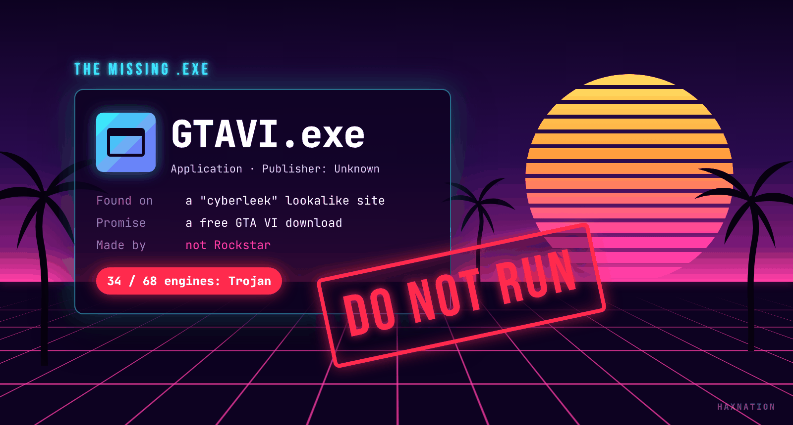
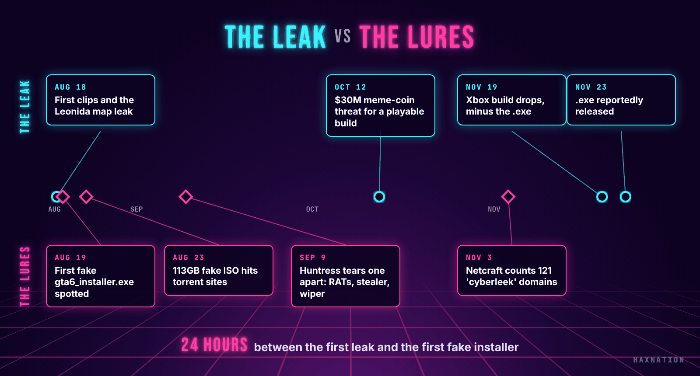
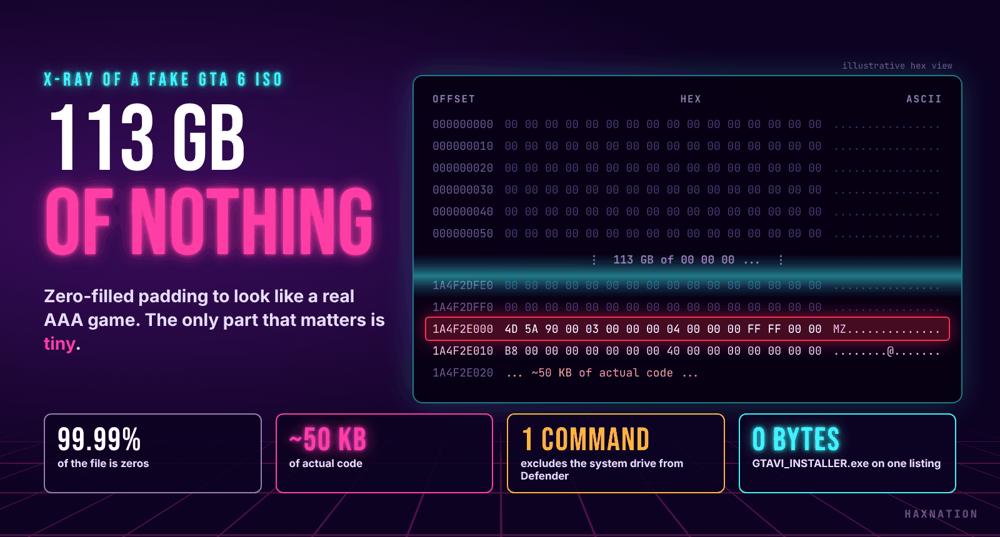
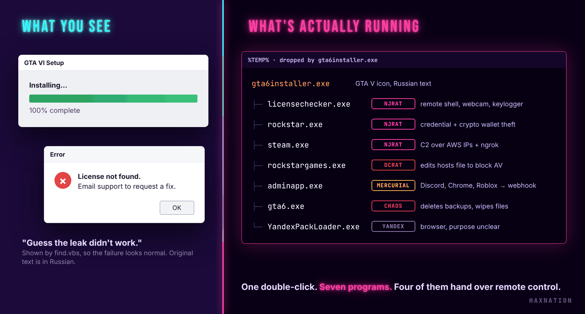
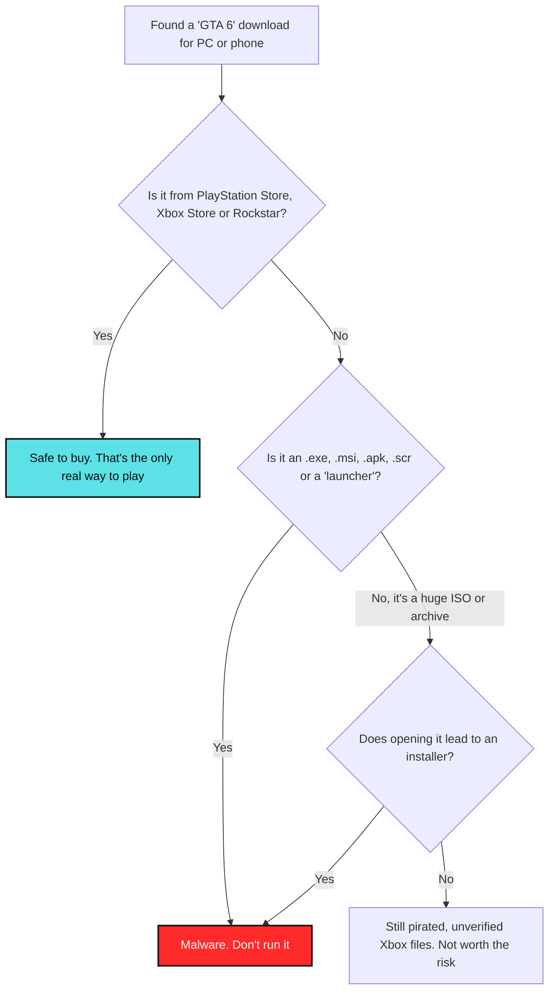

On November 19, the day GTA 6 launched on PS5 and Xbox, the leaker known as Cyberleek posted a short message on its site.

"It is done."

What followed was a claimed 209GB development build of the game, going out by torrent. Every file except one.

The main executable was held back on a countdown, to be released early if Cyberleek's meme coin hit a \$15 million market cap.

If you work in security, you already know what happens next. One missing file that millions of people want badly is the best malware lure anyone could design.



<!-- truncate -->

This post isn't about whether the leak is real, and it won't tell you where to find it. It's about the malware scene that has grown up around it since August, because that part is real, measurable, and still going.

What's in here:

- What actually leaked, and the money behind it
- Why a "missing piece" works so well on people
- A teardown of one fake GTA 6 installer, file by file
- Why even the real executable won't run on your PC
- A quick way to spot fakes, and what to do if you already ran one
- Indicators and hunting queries for defenders

## What actually leaked



The short version:

- August 18: Cyberleek starts posting gameplay clips and a map of Leonida. Malwarebytes spotted a malicious `gta6_installer.exe` the very next day.
- Late August: A 113GB "GTA VI ISO" spreads on torrent sites. People who opened it found it was almost entirely empty.
- October 12: Cyberleek threatens to release a 200GB+ playable build if its token reaches a \$30 million market cap. It never does, and two days later the group says it won't release the build.
- November 19: Launch day. Cyberleek posts what it calls Xbox build 1.0.2.1 from November 2026, about 209GB, minus the executable.
- November 23: The executable was reportedly posted about three hours before the countdown ended. Nobody has authenticated it, and Rockstar hasn't commented.

Kotaku couldn't verify the files. VGC described the screenshots as appearing to show a development build. Treat all of it as unconfirmed.

What is confirmed is the scam side. Kaspersky counted 27,416 detections of malware and unwanted apps tied to GTA VI between June and November 2026.

## The money behind the missing file

Cyberleek was never only about leaks.

Its campaign was tied to a Solana token, \$CYBERLEEK, and holders could pay to vote on what got leaked next. ESET's write-up, citing blockchain analysts BitOK, says the wallet that created the token claimed and sold 2,676.67 SOL in liquidity pool fees on August 27, roughly \$225,000 at November prices. BitOK cautions that this isn't the same as net profit.

Cyberleek-linked sites also sold a "GTA VI: Development Build" for \$40. ESET found no evidence that buyers received real files.

So before anyone else touched it, the "almost released" game was already being used to move money. The scammers who came next just copied the model.

## Why a missing .exe is the perfect lure

Three things make this work.

**The gap is a story the victim already believes.** Everyone following the leak knows the build is incomplete. So when a download says "here's the missing file," it isn't asking you to believe anything new. It's finishing a story you've been reading for weeks.

**The failure is built in.** The fake installer Huntress analysed warns you up front that the game may fail with a "License not found" error, then shows that exact error at the end. To the victim, the game didn't work, which was expected. Meanwhile four kinds of malware are running in the background.

**Size looks like proof.** A real AAA build is huge, so a fake one has to be too.



That 113GB ISO was about 99.99% zero-filled padding with roughly 50KB of actual code. Users who analysed it also found a PowerShell command that added the system drive to Windows Defender's exclusion list. One listing even showed `GTAVI_INSTALLER.exe` at 0 bytes, which is the "missing exe" pitch in a single file.

And the name itself is free to steal. Netcraft found 121 newly registered domains containing "cyberleek" between July and late October, 100 of them in August. Not all were malicious, but one served a `GTAVI.exe` that 34 of 68 VirusTotal engines flagged. Another pushed a "Cyberleek Launcher," flagged by 18 of 62, that then demanded \$100 in crypto.

## Inside one fake installer

Huntress pulled apart one of these oversized ISOs in September. It's worth walking through, because it shows how much a single double-click buys an attacker.



The ISO's main file is `gta6installer.exe`. It still uses a GTA V icon, and it shows a message in Russian saying the game is an unlicensed leak. Then it drops a set of GTA- and Rockstar-themed files into `%TEMP%`, checks for an internet connection, and installs everything at once:

| Payload | Disguised as | What it does |
|---|---|---|
| NJRAT (several copies) | `licensechecker.exe`, `rockstar.exe`, `steam.exe` | Remote shell, keylogging, webcam, screenshots, credential and crypto wallet theft. Adds its own firewall rules |
| DCRAT | `rockstargames.exe` | Screenshots, clipboard, window tracking, registry access. Edits the hosts file to block antivirus and telemetry domains |
| Mercurial Grabber | `adminapp.exe` | Steals Discord tokens, Chrome passwords and cookies, Roblox and Minecraft sessions, Windows product keys. Sends it all to a Discord webhook |
| Chaos ransomware | `gta6.exe` | Deletes shadow copies, disables recovery, encrypts files up to 200MB and overwrites larger ones. No way to pay, so it's a wiper |
| Yandex Browser | `YandexPackLoader.exe` | Installed alongside. Huntress doesn't establish why |

Last, a small `find.vbs` script shows the "License not found" message, and the victim assumes the install failed.

Look at what that payload list goes after. Discord tokens, Roblox and Minecraft sessions. Those accounts skew young, and so do the people most likely to search for a free GTA 6 download. The kit was built for exactly that crowd.

The wiper detail matters too. Chaos only runs if you have admin rights, and on a typical home gaming PC, you do.

## Even the real .exe won't run on your PC

This is the part most "GTA 6 PC download" posts leave out.

The build Cyberleek released is an Xbox Series build. Reporting on the November 23 file describes it as an Xbox executable, not a Windows release. Notebookcheck noted that no working Series X emulator exists. Fan projects are reportedly looking at porting it, but nobody has shown a verified playable PC version.

Rockstar hasn't announced a PC release either.

So here's a simple rule. If a file called `GTA6.exe` opens a setup wizard on your Windows PC, it is not the leaked build. Whatever it is, it was made by someone else, for a different reason.

There's a legal side as well. A leaked build is pirated software, and Take-Two has already filed multiple subpoenas to Discord for information on specific servers and users. Downloading it carries risk even when the file is clean.

## How to spot a fake



Red flags that showed up again and again in these campaigns:

- Any PC, mobile, beta, demo or "early access" version. Rockstar has announced none of these.
- A file name that tries too hard, like `CyberLeek-GTAVI-GTA6-PreBuild.torrent.exe`. That's a Windows program pretending to be a torrent.
- A download that's huge on the listing but tiny once you look inside, or tiny when it claims to be the whole game. Malwarebytes found one "installer" that was 1.1MB.
- Payment in crypto, or a "fundraiser" to unlock the file.
- Instructions to turn off your antivirus, or a warning that you'll see a "License not found" error.

## Already ran it?

Assume everything on that machine is compromised. Then, in this order:

1. Unplug it from the network. Wi-Fi off, cable out.
2. Use a different, clean device to change your passwords. Start with email, then Discord, Steam, Epic, Rockstar, Roblox and anything with saved payment details.
3. Log out of every session, not just the password. Infostealers take session cookies and tokens, and ESET points out that a stolen session can keep working after a password change.
4. Turn on two-factor authentication wherever it isn't on yet.
5. Move any crypto from wallets that were on that PC to a new wallet created on a clean device.
6. Reinstall Windows. Huntress recommends a full reimage, and with two RATs on board, cleanup isn't enough.

If you want to check a machine before deciding, these PowerShell lines look for traces of the Huntress sample. Run them as administrator. A clean result doesn't prove the PC is clean, but a hit tells you it isn't.

```powershell
# Drive or folder exclusions in Defender (the 113GB ISO added one for C:\)
Get-MpPreference | Select-Object -ExpandProperty ExclusionPath

# Non-comment lines in the hosts file (DCRAT blocks AV domains here)
Get-Content "$env:windir\System32\drivers\etc\hosts" |
  Where-Object { $_ -match '\S' -and $_ -notmatch '^\s*#' }

# The real svchost.exe lives in System32, never in AppData
Test-Path "$env:APPDATA\svchost.exe"

# Ransom notes dropped by the Chaos wiper
Get-ChildItem $env:USERPROFILE -Recurse -Filter read_it.txt -ErrorAction SilentlyContinue |
  Select-Object -First 5 FullName

# Firewall rules that point at programs in Temp (NJRAT adds its own)
Get-NetFirewallApplicationFilter |
  Where-Object { $_.Program -like '*\AppData\Local\Temp\*' } |
  Select-Object Program
```

## For defenders

GTA 6 lures don't stay on gaming PCs. They reach work laptops, family devices, and student machines in college labs. If you run a SOC or look after a campus network, these are worth adding to your watchlists.

Indicators from Huntress's analysis (defanged):

| Type | Indicator | Role |
|---|---|---|
| IP | `35.157.111[.]131`, `3.68.56[.]232`, `3.67.15[.]169` | NJRAT command and control |
| Host | `7.tcp.eu.ngrok[.]io:12684` | NJRAT tunnel |
| Domain | `a0700877.xsph[.]ru` (`141.8.197[.]42`) | DCRAT command and control |
| URL | `clck[.]ru/34uJnp` | Connectivity check |
| MD5 | `a15e280a3fd65dfaa243bbe2dbf45e97` | `gta6installer.exe` |
| MD5 | `dfdf5e5b78d2ec764c0e5641cf9a0d26` | `adminapp.exe` (Mercurial Grabber) |
| MD5 | `b9648ec8cc806e7661aabcfc91dc836c` | `gta6.exe` (Chaos) |
| MD5 | `8da3fe3664d81226b0fb2a50a0537d4f` | `rockstargames.exe` (DCRAT loader) |

Hashes go stale fast, so behaviour is the better bet. If you're on Microsoft Defender for Endpoint, these KQL queries are a starting point:

```kql
// Defender exclusions added from the command line
DeviceProcessEvents
| where ProcessCommandLine has "Add-MpPreference" and ProcessCommandLine has "Exclusion"
| project Timestamp, DeviceName, AccountName, InitiatingProcessFileName, ProcessCommandLine

// Discord webhooks called by something that isn't Discord or a browser
DeviceNetworkEvents
| where RemoteUrl has "discord.com/api/webhooks"
| where InitiatingProcessFileName !in~ ("discord.exe", "chrome.exe", "msedge.exe", "firefox.exe")
| project Timestamp, DeviceName, InitiatingProcessFolderPath, RemoteUrl

// Shadow copy deletion and recovery being switched off
DeviceProcessEvents
| where (FileName =~ "vssadmin.exe" and ProcessCommandLine has "delete shadows")
    or (FileName =~ "bcdedit.exe" and ProcessCommandLine has_any ("recoveryenabled", "bootstatuspolicy"))
| project Timestamp, DeviceName, AccountName, InitiatingProcessFolderPath, ProcessCommandLine
```

Also worth alerting on: writes to the hosts file, new firewall rules created by executables in `%TEMP%`, and outbound connections to ngrok from endpoints that have no business using it.

## The real leak is the attention

Whether or not Cyberleek's files are genuine, the pattern is the same one we see every time something big is about to drop. A real event creates a gap. Attackers fill it with whatever people are already waiting for.

This time it was an .exe.

Next time it'll be a "PC port", a "crack fix", or a "launcher update". The file name will change. The rule won't: if it isn't from an official store, don't run it.

## Sources

- [VGC: Cyberleek claims to release development build of GTA 6 (Nov 19, 2026)](https://www.videogameschronicle.com/news/cyberleek-claims-to-release-development-build-of-gta-6/)
- [Kotaku: Cyberleek tosses an alleged Xbox build of GTA 6 onto the internet](https://kotaku.com/cyberleek-is-threatening-to-unleash-chaos-again-after-tossing-an-alleged-xbox-build-of-gta-6-onto-the-internet-2000758544)
- [Notebookcheck: Cyberleek releases GTA 6 Xbox build](https://notebookcheck.net/Cyberleek-releases-GTA-6-Xbox-build-making-playable-PC-port-more-realistic.1454770.0.html)
- [KeenGamer: Cyberleek releases Xbox executable file (Nov 23, 2026)](https://www.keengamer.com/articles/news/gta-6-leaker-cyberleek-releases-xbox-executable-file-completing-alleged-leak/)
- [Huntress: Grand Theft Auto VI hype leads to malware (Sep 9, 2026)](https://www.huntress.com/blog/fake-gta6-download-malware-analysis)
- [Malwarebytes: Fake GTA 6 Extended Look and demo sites deliver an infostealer (Aug 24, 2026)](https://www.malwarebytes.com/blog/threat-intel/2026/08/fake-gta-6-extended-look-and-demo-sites-deliver-an-infostealer)
- [ESET WeLiveSecurity: GTA VI isn't out yet, and the scams are already in full swing (Nov 13, 2026)](https://www.welivesecurity.com/en/cybersecurity/gta-vi-isnt-out-yet-scams-full-swing/)
- [Help Net Security: Scammers capitalize on GTA 6 hype (Netcraft research, Nov 5, 2026)](https://helpnetsecurity.com/2026/11/05/gta-6-scams-fake-leaks-early-access)
- [Hackread: Fake GTA VI download sites push malware ahead of launch](https://hackread.com/fake-gta-vi-download-sites-malware-launch/)
- [TweakTown: Multiple 'CyberLeek full build' downloads appear online](https://www.tweaktown.com/news/113880/gta-6-leak-claims-explode-as-multiple-cyberleek-full-build-downloads-appear-online/index.html)
- [TechRadar: Fake GTA VI ISO is 99.99% empty zeroes with a tiny virus attached](https://techradar.com/pro/of-course-this-fake-gta-vi-iso-download-is-malware-testers-reveal-113gb-download-is-99-99-empty-zeroes-with-a-tiny-virus-attached)
- [Pokde: Kaspersky records over 27,000 GTA 6-related malware detections](https://pokde.net/?p=266951)
- [Tech Insider: Cyberleek leak timeline](https://tech-insider.org/gta-6-leak-cyberleek/)
