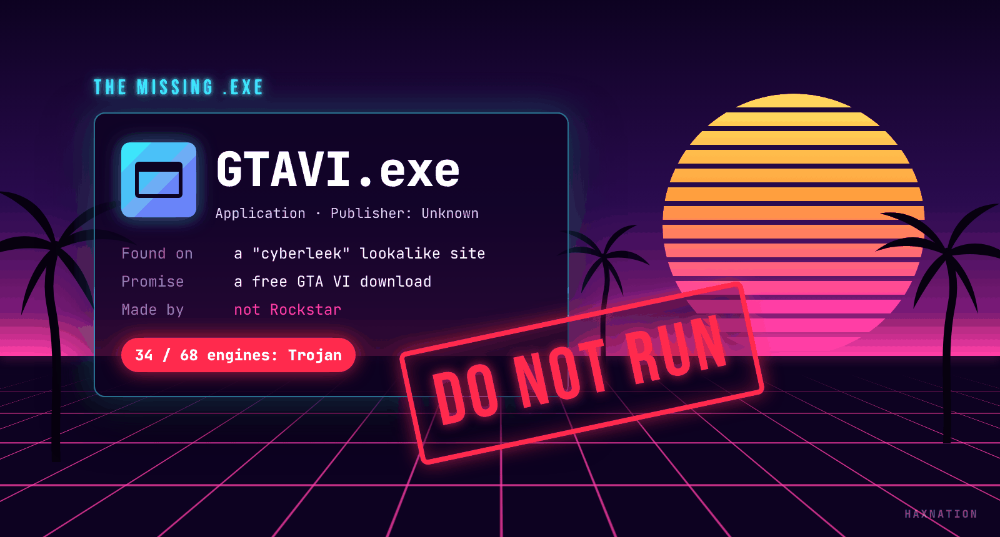
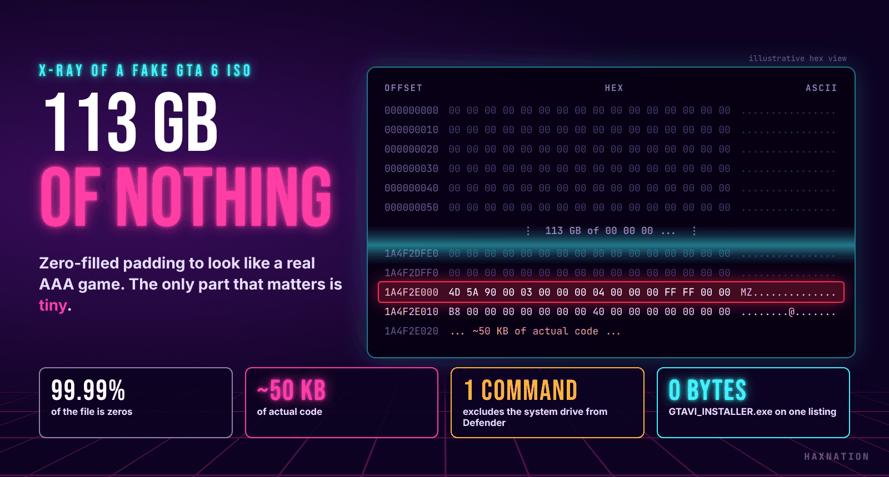
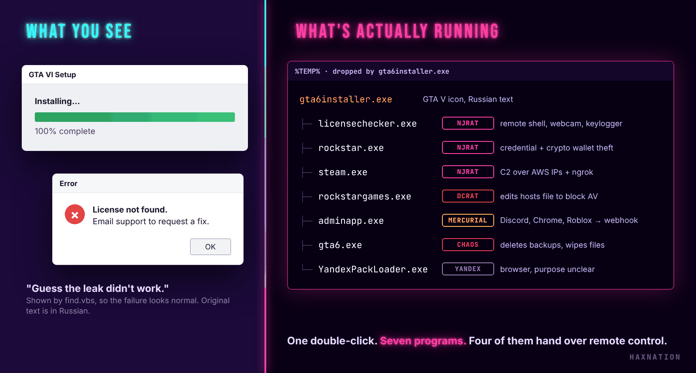

GTA 6 came out on November 19, on PS5 and Xbox only.

The same day, a leaker called Cyberleek put a 209GB copy of the game online. It was complete except for one file: the .exe, the file that actually starts the game.

That missing file is now the most dangerous part of this whole leak.

Not because of what Cyberleek might do with it. Because of what scammers are doing with it.

<!-- truncate -->

:::tip The short version

- There is no GTA 6 for PC. Not an official one, and not a leaked one that works.
- Any "GTA 6 .exe" or installer you find for Windows is not the game. Security researchers keep finding malware inside them.
- If you already ran one, disconnect that PC and change your passwords from another device. The full steps are at the end.

:::

## What actually leaked?

Cyberleek has been leaking GTA 6 since August 18, starting with gameplay clips and a map of the game's world.

On launch day, it released what it says is a [development build of the Xbox version](https://www.videogameschronicle.com/news/cyberleek-claims-to-release-development-build-of-gta-6/). Every file except the executable, which it held back on a countdown. It said it would release that file early if fans pushed its crypto coin to a [\$15 million market value](https://kotaku.com/cyberleek-is-threatening-to-unleash-chaos-again-after-tossing-an-alleged-xbox-build-of-gta-6-onto-the-internet-2000758544).

On November 23, the executable was [reportedly posted](https://www.keengamer.com/articles/news/gta-6-leaker-cyberleek-releases-xbox-executable-file-completing-alleged-leak/), a few hours before the countdown ran out.

Nobody has confirmed that any of it is real. Not Rockstar, and not the gaming sites reporting on it.

That hasn't slowed the hype down. A TikTok claiming the ["GTA 6 ENTIRE GAME WAS LEAKED"](https://www.tweaktown.com/news/113880/gta-6-leak-claims-explode-as-multiple-cyberleek-full-build-downloads-appear-online/index.html) has more than 306,000 likes.

## Why is a missing file such good bait?

Put yourself in the shoes of someone who has been following this.

You've seen the leaked clips. You know a build exists, because every gaming site wrote about it. You also know it's missing one file. Then someone in a Discord server or a Telegram group posts a link: "here's the exe."

That link isn't asking you to believe anything new. It's finishing a story you've already been following for months. That's why it works.

Scammers figured this out early. The day after Cyberleek's first clips appeared, Malwarebytes spotted a [fake `gta6_installer.exe`](https://www.malwarebytes.com/blog/threat-intel/2026/08/fake-gta-6-extended-look-and-demo-sites-deliver-an-infostealer) that steals saved passwords. One day. That's how fast this moves.

They also know how to make a fake look real. A real game is huge, so a fake one has to be huge too.

In August, a 113GB "GTA 6 PC build" spread across torrent sites. When people opened it up, it was [almost entirely empty filler with a roughly 50KB virus](https://www.notebookcheck.net/A-113-GB-GTA-6-build-is-circulating-online-but-it-appears-to-be-fake.1375822.0.html) inside. One person who analysed it said the malware [tries to switch off Windows Defender](https://cybernews.com/security/gta-six-game-build-fake-leak/).

113GB of nothing, so that 50KB of something looks legit.

Even the name "Cyberleek" has become bait. Security firm Netcraft found [121 new websites](https://www.welivesecurity.com/en/cybersecurity/gta-vi-isnt-out-yet-scams-full-swing/) with "cyberleek" in the address. One of them handed out a `GTAVI.exe` that 34 out of 68 antivirus engines flagged as malicious.

## What does a fake one do to your PC?

In September, security firm Huntress took one of these fake GTA 6 downloads apart and [documented every step](https://www.huntress.com/blog/fake-gta6-download-malware-analysis). Here's what happens when you run it.

You open the download and run `gta6installer.exe`. It has a GTA icon. It shows a message saying this is an unlicensed leak, and that the game might fail with a "License not found" error.

Remember that warning. It comes back later.

While you're reading it, the installer quietly drops a set of files with Rockstar and GTA-sounding names into a temporary folder and starts all of them:

- Remote-access tools (several copies of NJRAT, plus DCRAT). They let a stranger use your PC as if they were sitting at it. They can watch your screen, record what you type, turn on your webcam and go through your files.
- A password stealer (Mercurial Grabber). It takes your Discord login, the passwords and cookies saved in Chrome, and your Roblox and Minecraft accounts, then sends all of it to the attacker.
- A file destroyer disguised as ransomware (Chaos). If your account has admin rights, which on a home PC it usually does, it deletes Windows' restore points and then scrambles or overwrites your files. It leaves a ransom note, but there's no way to pay. Your files are simply gone.

Then a small box pops up: "License not found."

That's the trick. You were told it might fail, and it failed. So you click OK, assume the leak was fake, and move on with your day.

Everything it installed keeps running in the background.

Notice who it targets, too. Discord, Roblox, Minecraft. Those accounts skew young, and so does the crowd most likely to go looking for a free GTA 6 download.

## Can the real leak even run on a PC?

No.

Even if Cyberleek's files are genuine, they're an Xbox build. The executable that reportedly appeared on November 23 is an [Xbox file, not a Windows program](https://www.keengamer.com/articles/news/gta-6-leaker-cyberleek-releases-xbox-executable-file-completing-alleged-leak/), and there's [no working Xbox Series emulator](https://notebookcheck.net/Cyberleek-releases-GTA-6-Xbox-build-making-playable-PC-port-more-realistic.1454770.0.html) that could run it on a PC. Rockstar hasn't announced a PC version of the game either.

So here's the rule:

If a file called `GTA6.exe` opens a setup screen on your Windows PC, it is not the leak. Someone else made it, and not so you could play GTA.

There's a legal risk as well. A leaked build is pirated software, and Take-Two has already [sent subpoenas to Discord](https://www.videogameschronicle.com/news/cyberleek-claims-to-release-development-build-of-gta-6/) asking for information about specific servers and users.

## How do you spot a fake?

Ask yourself four questions:

1. Is it for PC or for your phone? Then it's fake. GTA 6 only exists on PS5 and Xbox.
2. Is it an .exe, an installer, a "launcher" or an .apk? Then it's fake. Even the real leak isn't a Windows program.
3. Does it warn you about errors, or ask you to turn off your antivirus? That's the scam preparing you for what comes next.
4. Does it want money or crypto to "unlock" the game? Sites linked to the Cyberleek name have been selling a ["development build" for \$40](https://www.welivesecurity.com/en/cybersecurity/gta-vi-isnt-out-yet-scams-full-swing/), and there's no evidence any buyer got real files.

The only safe place to get GTA 6 is the PlayStation Store, the Xbox Store, or a real retailer.

## What if you already ran one?

Don't panic, but act today. In this order:

1. Disconnect that PC from the internet.
2. On a different device, like your phone, change your passwords. Start with your email, then Discord, Steam, Epic, Rockstar, and any account with a saved card.
3. On each of those accounts, log out of every device, not just the one you're using. Stolen cookies can keep an attacker logged in even after you change your password.
4. Turn on two-factor authentication wherever you can.
5. If you had a crypto wallet on that PC, move the funds to a new wallet created on a clean device.
6. Reinstall Windows. With remote-access tools on the machine, an antivirus scan isn't enough. Huntress recommends a full reinstall as well.

## The file name will change

This time the bait was a missing .exe.

Next time it'll be a "PC port", a "crack fix", or a "launcher update". Whatever people are waiting for that week, that's what the trap will be called.

The rule stays the same. If it's not from an official store, don't run it.

## Sources

- [VGC: Cyberleek claims to release development build of GTA 6](https://www.videogameschronicle.com/news/cyberleek-claims-to-release-development-build-of-gta-6/)
- [Kotaku: Cyberleek tosses an alleged Xbox build of GTA 6 onto the internet](https://kotaku.com/cyberleek-is-threatening-to-unleash-chaos-again-after-tossing-an-alleged-xbox-build-of-gta-6-onto-the-internet-2000758544)
- [KeenGamer: Cyberleek releases Xbox executable file](https://www.keengamer.com/articles/news/gta-6-leaker-cyberleek-releases-xbox-executable-file-completing-alleged-leak/)
- [Notebookcheck: Cyberleek releases GTA 6 Xbox build](https://notebookcheck.net/Cyberleek-releases-GTA-6-Xbox-build-making-playable-PC-port-more-realistic.1454770.0.html)
- [Notebookcheck: A 113GB GTA 6 build is circulating online, but it appears to be fake](https://www.notebookcheck.net/A-113-GB-GTA-6-build-is-circulating-online-but-it-appears-to-be-fake.1375822.0.html)
- [Cybernews: Scammers post fake GTA 6 pre-release build to spread malware](https://cybernews.com/security/gta-six-game-build-fake-leak/)
- [Malwarebytes: Fake GTA 6 Extended Look and demo sites deliver an infostealer](https://www.malwarebytes.com/blog/threat-intel/2026/08/fake-gta-6-extended-look-and-demo-sites-deliver-an-infostealer)
- [ESET WeLiveSecurity: GTA VI isn't out yet, and the scams are already in full swing](https://www.welivesecurity.com/en/cybersecurity/gta-vi-isnt-out-yet-scams-full-swing/)
- [Huntress: Fake GTA 6 download malware analysis](https://www.huntress.com/blog/fake-gta6-download-malware-analysis)
- [TweakTown: Multiple 'CyberLeek full build' downloads appear online](https://www.tweaktown.com/news/113880/gta-6-leak-claims-explode-as-multiple-cyberleek-full-build-downloads-appear-online/index.html)
