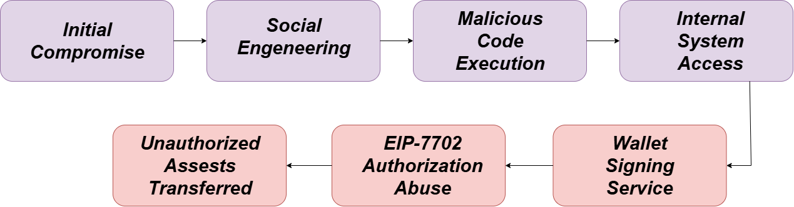

# Bella Ciao, Billions: Inside the Binance Crypto Heist

*How a seemingly normal recruitment process became part of a sophisticated cyberattack.*

## 1. When Billions Disappeared in 20 Minutes

October 2026 was already a busy month for cybersecurity news. But just as the month was coming to an end, another incident made headlines across the world.

Binance, one of the world's largest cryptocurrency exchanges, experienced a significant security incident on October 29, 2026, where around $6.34 billion worth of digital assets were compromised.

And here's the part that's hard to ignore: most of the stolen money was transferred in about just 20 minutes.

But this wasn't simply a case of someone breaking into a system and walking away with the money. One of the entry points was something most professionals would consider very normal: a job interview.

Yes, a job interview.

The operation was a complex, multi-stage attack that included social engineering, compromised devices, internal systems, and the exploitation of Ethereum's EIP-7702 authorisation mechanism.

So, let's unpack the whole lore, from how the attack began to how it eventually unfolded.

<!-- truncate -->

## 2. First, A Little Crypto 101

Let's first get a quick grasp of what we're talking about before we get into the details of how billions of dollars in digital assets were transferred.

### What is cryptocurrency?

Cryptocurrency is a digital currency that works with cryptographic methods and blockchain technology. The transactions are not recorded on a centralised ledger, but on a distributed digital ledger known as a blockchain.

### Where does cryptocurrency go?

A cryptocurrency wallet does not contain the actual currency. A crypto wallet manages the cryptographic keys that allow users to access and authorise transactions involving their digital assets.

There are two types that are commonly discussed:

- **Hot Wallets:** These are connected to the internet and are easy to use, but also expose users to online risks.
- **Cold Wallets:** Stored offline or away from internet-connected systems, minimising exposure to remote attacks

### So, what is a cryptocurrency exchange?

It is like a virtual marketplace where people can purchase, sell and trade cryptocurrencies.

One such platform is Binance.

## 3. Enter Binance

Binance is a leading cryptocurrency exchange that provides more than just trading services for digital currencies. It provides trading, wallet infrastructure and several other digital asset services.

It operates digital assets using various wallet systems, similar to other exchanges.

Hot wallets are especially crucial because they enable frequent transactions and withdrawals. However, their connectivity also makes securing the associated infrastructure critical.

But this leads to the actual question: what happens when attackers get access to the systems that authorise those transactions?

Unfortunately, Binance found out the hard way.

## 4. The Attack: A Job Interview with an Agenda

The interesting thing about this incident is that the attack did not start on October 29.

Binance's investigation revealed that the larger campaign dates back to June 2026.

### June 2026 : The Initial Compromise

An engineer working in Binance's Wallet DevOps team downloaded a tampered Homebrew installation while attempting to install an AI coding tool.

This supply-chain breach exposed the engineer's workstation and those of colleagues associated with Binance's wallet infrastructure.

### September 1, 2026 : The Recruitment Trap

An attacker approached another Binance software engineer through a legitimate job hunting platform.

The attacker pretended to be a project director from a fake company.

What ensued was a fairly normal recruitment process:

- The employee was contacted through a job hunting platform.
- A first round video interview was set up with a person who said they were an HR representative.
- The interviewer provided social media profiles, personal photos and videos to build credibility.
- A second interview was conducted with a man who said he was the CEO of the company.
- At the end, the employee was instructed to download and run a coding task from a web repository.

Sounds like a regular technical interview, doesn't it?

Except the assignment contained malicious code.

The employee ran it on a Binance work laptop, providing another entry point for the attackers.

### A Closer Look: How the Malicious Code Tampered with pyenv

Binance's investigation revealed something particularly interesting about the malware. Instead of simply installing an obviously suspicious application, it tampered with an existing development tool called `pyenv`.

For anyone unfamiliar, pyenv is a tool developers use to manage different Python versions on their systems.

The attackers replaced its legitimate executable with a modified version while keeping the same filename. This made the malicious file appear like the familiar tool.

Here's a simplified breakdown of the operations documented by Binance:

```text
CREATE   pyenv_
MODIFY   pyenv_
DELETE   pyenv          (original executable)
RENAME   pyenv_ → pyenv (modified replacement)
DELETE   /opt/homebrew/bin/pyenv
CREATE   symbolic link + spawn Zsh
```

Notice something? The legitimate executable was removed and replaced, but the familiar filename remained.

This is particularly concerning because developers generally trust tools already installed in their working environment. Replacing a legitimate component with a malicious version can make suspicious activity harder to recognise.

### October 20 : Expanding Access

Binance's investigation revealed that the attackers exploited compromised devices and an internal AI tool to gain access to other engineers, credentials and critical systems.

### October 29 : The Heist

The attackers used unauthorised access to Binance's internal wallet-signing infrastructure and started transactions outside the normal withdrawal process.

## 5. Under the Hood: Understanding EIP-7702

Let's first understand what EIP-7702 is before we get into how it was abused.

### What is EIP-7702?

EIP is an acronym for Ethereum Improvement Proposal. EIP-7702 is an Ethereum Improvement Proposal that enables an Externally Owned Account (EOA) to temporarily delegate some execution capabilities to a smart contract.

In simpler terms, it enables a regular Ethereum account to utilise smart-contract functionality without permanently turning into a smart contract account.

This offers advantages like transaction batching, sponsored transactions and more flexible account functionality.

However, there is an important security factor: the account owner has to approve the delegation.

When an attacker can exploit that authorisation, legitimate functionality can become a pathway to unauthorised actions.

### How does this relate to the Binance incident?

Binance's investigation revealed that the attackers gained access to its internal wallet-signing service.

They then exploited EIP-7702 authorisations to give an attacker-controlled smart contract partial execution rights to a Binance hot wallet.

Importantly, this did not involve the wallet's private key being leaked.

Binance stated that it did not find any evidence of wallet private keys being exposed.

The problem was the misuse of the transaction-authorisation mechanism itself.

### How Did the Attackers Make It Work?

Binance's report revealed another important detail: the attackers submitted 50 signing transactions to manipulate the account nonce and establish malicious delegation authorisations.

### So, what exactly is a nonce?

A nonce is essentially a counter associated with an Ethereum account. It helps keep transactions in the correct order and prevents the same transaction from being processed more than once.

By manipulating this counter, the attackers were able to establish the malicious authorisations needed for their operation.

### But why was stopping them so difficult?

The affected hot wallet used Multi-Party Computation (MPC).

In simple terms, MPC distributes the transaction-signing process across multiple parties instead of relying on one complete private key. This adds another layer of security.

However, it also made revoking the malicious authorisations more complicated. There wasn't one single private key that could simply be used to remove them.

Another important detail was that these authorisations already existed on the blockchain. Suspending withdrawals or shutting down Binance's usual wallet services could not automatically remove them.

Binance therefore had to execute additional on-chain transactions to revoke the malicious delegations.

This highlights an important difference: stopping new transactions and revoking permissions that already exist on the blockchain are two very different challenges

## 6. Breaking Down the Attack Methodology

It was not a single vulnerability that caused the incident, but several stages.

The attack chain is as follows:

- **Initial Access:** Entry points were gained through social engineering and a software supply-chain compromise.
- **Endpoint Compromise:** Malicious software was run on compromised devices.
- **Credential and Internal Access:** Attackers gained access through compromised devices, credentials and internal tooling.
- **Wallet-Signing Access:** Attackers were able to access internal transaction-signing operations without authorisation.
- **EIP-7702 Authorisation Abuse:** Malicious delegation authorisations were set up.
- **Unauthorised Transfers:** Digital assets were sent to addresses controlled by the attacker.



## 7. Following the Money

The attackers transferred digital assets to various blockchain networks and addresses.

According to reports from blockchain intelligence companies, the transfers totalled around $6.3 billion across ten blockchains, with a significant portion of the transfers occurring in a very short time.

Funds were transferred between various addresses and networks, making them difficult to track and recover.

But blockchain transactions are public, and that's also a great resource for investigators to use when tracking stolen assets.

### Where did the missing money go?

As of November 3, 2026, Binance said it had frozen or intercepted about $2.85 billion.

The US Department of Justice, on November 23, filed a civil forfeiture action involving over $1.1 billion of USDC.

While it is not always possible to trace all stolen cryptocurrencies, collaboration between exchanges, asset issuers, blockchain intelligence companies and law enforcement can make a huge difference.

## 8. Damage Control: Binance's Response

Binance took several containment and recovery steps:

- Temporarily suspended withdrawals while security checks and remediation were carried out.
- Collaborated with blockchain intelligence partners and asset issuers to track and freeze affected assets.
- Took steps to revoke unauthorised EIP-7702 delegations.
- Reconstructed or replaced affected systems and devices.
- Revoked credentials and enhanced device controls.
- Enhanced AI-powered behavioural anomaly detection.

Binance also said it would cover the losses from the incident through its SAFU fund and corporate treasury, rather than passing them on to users.

The incident pointed to a key technical issue: withdrawals could not be stopped simply by shutting down the usual wallet infrastructure because the malicious authorisations had already been written on the blockchain.

More on-chain revocation operations were needed.

At 00:10 UTC on October 30, Binance executed a new authorisation from the affected hot wallet to the zero address, removing the malicious EIP-7702 delegation code.

This was an important step in containing the attack and preventing further unauthorised execution.

## 9. Lessons and Recommendations: What Can We Learn?

This incident is a reminder that cybersecurity isn't just about firewalls, encryption or deploying the latest security tools. The weakest entry point is sometimes an interaction that looks completely harmless.

A few important takeaways:

### For Employees

- Check recruiters, companies and interviewers independently.
- Do not download or run untrusted assignments on company equipment.
- Do not use personal devices for work.
- Report any suspicious recruitment practices to the security team.
- Be wary of unexpected links, repositories and software installations.

### For Organisations

- Enable Endpoint Detection and Response (EDR) on employee devices.
- Use least-privilege access controls.
- Enforce strong credential and session management.
- Monitor unusual access to sensitive systems.
- Separate critical signing infrastructure and enhance transaction-authorisation controls.
- Conduct regular security assessments and incident-response exercises.
- Use secure sandboxes for external coding assignments.

### For Cryptocurrency Users

- Don't store all digital assets in one exchange.
- Know the difference between exchange custody and self-custody.
- Check wallet permissions and smart-contract delegations.
- Check transaction details before authorising transactions.

Last but not least, employee awareness training is important. (Duh!)

But awareness alone isn't enough. Technical controls are also required to minimise the impact of a mistake by an individual.

## 10. Final Thoughts

The Binance incident is a prime example of how a seemingly innocuous interaction can escalate into a much larger cyberattack.

A recruitment conversation, a malicious download, compromised internal access and an abused transaction-authorisation mechanism eventually came together in a multibillion-dollar theft.

The bigger lesson?

Not all attackers have to break through the front door. Sometimes, they simply convince someone to open it.

In cybersecurity, however, it can be a costly error to trust without verification.

Bella Ciao, indeed.

## References & Further Reading

- [Binance – October 29 Security Incident: Initial Findings and Response Update](https://www.binance.com/en-NZ/blog/community/3229153443759566763)
- [Binance – Security Incident Update, October 30](https://www.binance.com/en/support/announcement/detail/c5a8729a97ac486d963784d96c5642d7)
- [Inc. – The Binance Heist Wasn't Just a Cybersecurity Failure. It Started With a Job Interview](https://www.inc.com/stefanie-fackrell/the-binance-heist-wasnt-just-a-cybersecurity-failure-it-started-with-a-job-interview/91440145)
- [US Department of Justice – Cryptocurrency Forfeiture Action](https://www.justice.gov/usao-dc/pr/united-states-files-action-recover-more-1-billion-cryptocurrency-assets-related-north)
- [Ethereum Improvement Proposal – EIP-7702](https://eips.ethereum.org/EIPS/eip-7702)
- [EIP-7702 – Technical Overview](https://eip7702.io/)
- [5050 Markets – Binance Heist Warning: AI May Make Cybercrime Easier](https://5050markets.com/ke/news/binance-heist-ai-cybercrime-warning)
- [NPR – Binance Crypto Exchange Cyber Heist](https://www.npr.org/2026/11/03/nx-s1-6027799/binance-crypto-exchange-cyber-heist)
- [BBC – Binance Incident Coverage](https://www.bbc.com/news/articles/cwj34gdmnly4o)
